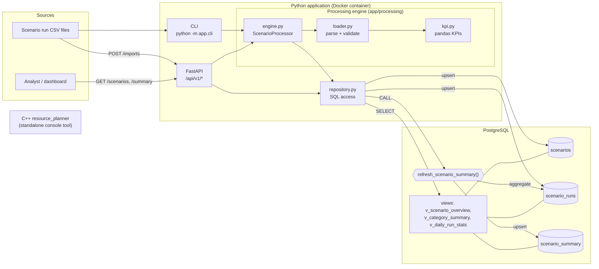
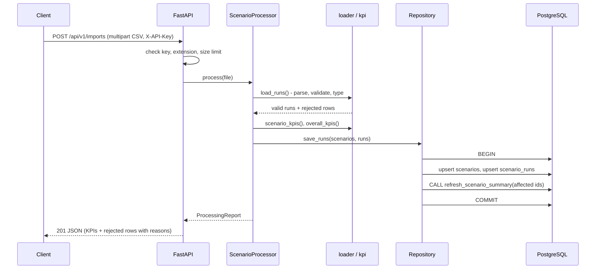

# Architecture

## Component view

## Import sequence

## Key decisions

| Decision | Reason |
|---|---|
| Bad rows are skipped and reported instead of failing the file | One typo should not block thousands of good runs; the caller still gets line numbers and reasons. |
| Whole import runs in one transaction | Readers never see a half-loaded file; a failure leaves the DB unchanged. |
| Runs are upserted on `run_id` | Re-sending a file is safe (idempotent), and corrected data overwrites the old values. |
| `scenario_summary` is recalculated in SQL over full history for affected scenarios only | KPIs stay correct across many imports; the cost scales with the file, not the table. |
| KPIs are also computed in pandas per file | Gives immediate feedback for dry runs and the import response; an integration test checks both implementations agree. |
| Repository layer holds all SQL | The API and the engine can be tested without a database. |
| Sync endpoints for DB/pandas work | psycopg2 and pandas are blocking; FastAPI runs sync endpoints in a thread pool so the event loop is never blocked. |
